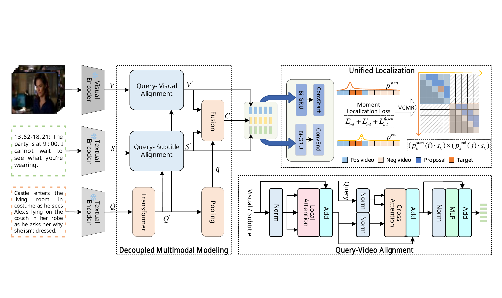

<div align="center">

# Video Corpus Moment Retrieval via<br>Decoupled Multimodal Modeling and Unified Localization

### DeMUL · IEEE TCSVT 2026

[Yong Yang](https://github.com/Yongyangyyy)<sup>1</sup>, Meng Liu<sup>2</sup>, Xuemeng Song<sup>3</sup>, Na Zheng<sup>4</sup>, Ke Lv<sup>5,6</sup>, Weili Guan<sup>1,†</sup>

<sup>1</sup>Harbin Institute of Technology, Shenzhen &nbsp;
<sup>2</sup>Shandong University &nbsp;
<sup>3</sup>Southern University of Science and Technology &nbsp;
<sup>4</sup>National University of Singapore<br>
<sup>5</sup>University of Chinese Academy of Sciences &nbsp;
<sup>6</sup>Peng Cheng Laboratory

<sup>†</sup>Corresponding author

[](https://ieeexplore.ieee.org/document/11574042)
[](https://doi.org/10.1109/TCSVT.2026.3705906)
[](LICENSE)

</div>

## Updates

- **2026-10:** Updated the README with the official citation and the framework figure.
- **2026-06:** DeMUL is published in **IEEE TCSVT** (vol. 36, no. 10).
- **2026-05:** Released the code and the pre-trained TVR checkpoint.

## Overview

Video Corpus Moment Retrieval (VCMR) aims to retrieve a target temporal moment from a large corpus of untrimmed videos given a natural-language query. Existing methods typically fuse multiple video modalities (e.g., visual content and subtitles) *before* aligning them with the query, which obscures modality-specific discriminative cues and reduces robustness when modalities are noisy, imbalanced, or unavailable. **DeMUL** addresses this with two key designs:

- **Decoupled Multimodal Modeling:** the query is aligned with the visual and subtitle modalities *separately*; the query-aligned modality-specific representations are then integrated for temporal localization, preserving modality-specific cues while exploiting complementary multimodal evidence.
- **Unified Localization:** a unified moment localization head jointly optimizes unimodal and multimodal branches in a shared prediction space, without auxiliary distillation or extra supervision.

DeMUL achieves state-of-the-art VCMR performance on **TVR** and **DiDeMo**, and remains robust under modality-missing and degraded-input conditions.

<p align="center">
  
</p>

## Project Structure

```
DeMUL/
├── model/
│   ├── transformer.py   # LayerNorm, MaskedMHA/MHCA, LocalMaskedMHCA, TransformerBlock
│   ├── layers.py        # LinearLayer, NetVLAD, ConvSE
│   ├── encoder.py       # BidVideoQueryEncoder, QueryWeightEncoder
│   ├── head.py          # MomentLocalizationHead (BiGRU + ConvSE)
│   └── demul.py         # DeMUL main model
├── config/
│   ├── config.py
│   ├── model_config.json
│   ├── tvr_data_config.json
│   └── didemo_data_config.json
├── data_loader/
│   └── dataset.py
├── optim/
│   └── adamw.py
├── utils/
├── standalone_eval/
│   └── eval.py
├── train.py
├── inference.py
├── checkpoints/         # pre-trained TVR weights
└── scripts/
    ├── train_tvr.sh
    ├── train_didemo.sh
    ├── inference.sh
    └── download_weights.sh
```

## Installation

### Requirements

- Linux with an NVIDIA GPU.
- Python 3.10.

Clone the repository:

```bash
git clone https://github.com/Yongyangyyy/DeMUL.git
cd DeMUL
```

Install dependencies:

```bash
# Option 1: pip
pip install -r requirements.txt

# Option 2: conda (recommended for CUDA)
conda create -n demul python=3.10 -y
conda activate demul
pip install torch torchvision --index-url https://download.pytorch.org/whl/cu124
pip install -r requirements.txt
```

Key dependencies: `torch>=2.0`, `tensorboard`, `lmdb`, `msgpack`, `msgpack-numpy`, `easydict`, `tqdm`.

## Data and Checkpoints

### Prepare feature files and data

We use the same pre-extracted features as [CONQUER](https://github.com/houzhijian/CONQUER). Please refer to their data preparation instructions.

#### TVR

Download [tvr_feature_release.tar.gz](https://drive.google.com/file/d/1DFnMNH-oi6-cZbl1coXqa_KjtsIsObxG/view?usp=sharing) (21GB). After downloading, extract it to **YOUR DATA STORAGE** directory:

```bash
tar zxvf path/to/tvr_feature_release.tar.gz
```

You should see `tvr_feature_release` under **YOUR DATA STORAGE** directory. It contains:

- **Visual features** (ResNet + SlowFast) from [HERO](https://github.com/linjieli222/HERO/)
- **Text features** (subtitle and query, fine-tuned RoBERTa) from [XML / TVRetrieval](https://github.com/jayleicn/TVRetrieval)

For details on feature extraction, see [visual feature extraction](https://github.com/linjieli222/HERO_Video_Feature_Extractor) and [text feature extraction](https://github.com/jayleicn/TVRetrieval/tree/master/utils/text_feature).

Then modify `root_path` in `config/tvr_data_config.json`:

```json
"root_path": "/path/to/tvr_feature_release"
```

#### DiDeMo

DiDeMo features follow the same CONQUER-compatible directory layout. Prepare `didemo_feature_release` with the same visual / text feature format, then set `root_path` in `config/didemo_data_config.json`:

```json
"root_path": "/path/to/didemo_feature_release"
```

### Model Zoo

We release the best pre-trained **TVR** checkpoint. Metrics are reported on the **validation** split with NMS threshold 0.7.

| Dataset | VCMR R@1<br/>(IoU=0.7) | VCMR R@5<br/>(IoU=0.7) | SVMR R@1<br/>(IoU=0.7) | VR R@1 | Download |
|:-------:|:----------------------:|:----------------------:|:----------------------:|:------:|:--------:|
| TVR | 11.92 | 25.27 | 26.84 | 29.01 | [model.ckpt](checkpoints/demul_tvr/model.ckpt) |

> Full metrics and training config are bundled in [`checkpoints/demul_tvr/`](checkpoints/demul_tvr/).

### Download

**Option 1 — script**

```bash
bash scripts/download_weights.sh
```

**Option 2 — manual**

```bash
wget https://github.com/Yongyangyyy/DeMUL/raw/main/checkpoints/demul_tvr/model.ckpt \
     -P checkpoints/demul_tvr/
wget https://github.com/Yongyangyyy/DeMUL/raw/main/checkpoints/demul_tvr/opt.json \
     -P checkpoints/demul_tvr/
wget https://github.com/Yongyangyyy/DeMUL/raw/main/checkpoints/demul_tvr/metrics.json \
     -P checkpoints/demul_tvr/
```

## Training

### TVR

```bash
bash scripts/train_tvr.sh demul_tvr_run1
```

Or directly:

```bash
python train.py \
    --exp_id my_run \
    --dset_name tvr \
    --dataset_config config/tvr_data_config.json \
    --model_config   config/model_config.json
```

### DiDeMo

```bash
bash scripts/train_didemo.sh demul_didemo_run1
```

To fine-tune from a TVR checkpoint:

```bash
bash scripts/train_didemo.sh demul_didemo_run1 2018 0 results/tvr-my_run-YYYY_MM_DD_HH_MM_SS
```

## Evaluation

Run inference with a trained checkpoint:

```bash
bash scripts/inference.sh results/tvr-my_run-YYYY_MM_DD_HH_MM_SS val
```

Or evaluate with the pre-trained weights:

```bash
bash scripts/inference.sh checkpoints/demul_tvr val
```

Checkpoints and logs are saved under `results/<exp_name>-<timestamp>/`.

## Acknowledgements

This codebase is built upon [CONQUER](https://github.com/houzhijian/CONQUER) and modified for DeMUL. We thank the CONQUER authors for open-sourcing their implementation.

If you use the data pipeline or evaluation protocol, please also cite CONQUER:

```bibtex
@inproceedings{hou2020conquer,
  title={CONQUER: Contextual Query-aware Ranking for Video Corpus Moment Retrieval},
  author={Hou, Zhijian and Ngo, Chong-Wah and Chan, Wing-Kwong},
  booktitle={Proceedings of the 29th ACM International Conference on Multimedia},
  year={2021}
}
```

We also thank the authors of [TVRetrieval](https://github.com/jayleicn/TVRetrieval), [HERO](https://github.com/linjieli222/HERO/) for their open-source contributions to VCMR research.

## Citation

If you find DeMUL useful in your research, please cite:

```bibtex
@article{yang2026demul,
  author={Yang, Yong and Liu, Meng and Song, Xuemeng and Zheng, Na and Lv, Ke and Guan, Weili},
  journal={IEEE Transactions on Circuits and Systems for Video Technology},
  title={Video Corpus Moment Retrieval via Decoupled Multimodal Modeling and Unified Localization},
  year={2026},
  volume={36},
  number={10},
  pages={15069-15081},
  doi={10.1109/TCSVT.2026.3705906}
}
```
